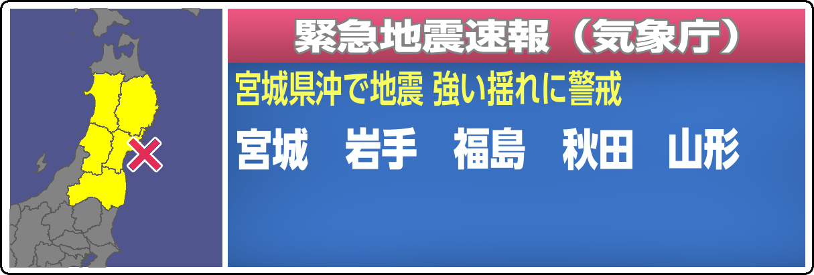
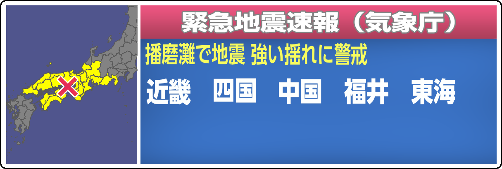
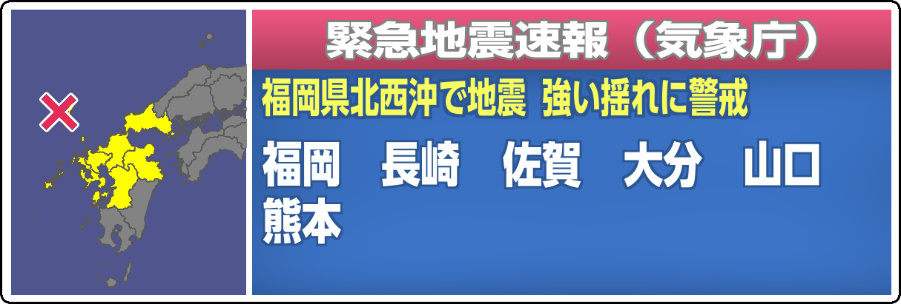

# NHK 緊急地震速報 画面生成器

用 Rust 从零实现的仿 NHK「緊急地震速報（気象庁）」画面生成器。不依赖任何图像库或 GUI 框架：
PNG 编解码、矢量填充与抗锯齿、CFF 字体轮廓解析、地图投影绘制、HTTP 服务全部为手写实现，
只用一个 `ttf-parser` 解析字体表。


## 效果图

**警报画面**（東北 5 県、府県予報区名一行装下）：



**取消画面**（取消报自动切换版式，地图与文字全部清空）：


**地区名自动整合**：当府県予報区名超过两行时，切换为地方予報区名。下面四例分别覆盖
「同地方全選」「跨三地方」「單独保留北陸福井」「岛屿区域独立列出」等情形：

| 用例 | 画面 |
|---|---|
| 近畿 + 四国 + 中国 + 福井 + 東海（震央：播磨灘） |  |
| 九州 + 中国 + 四国（震央：熊本県熊本地方） |  |
| 関東 + 伊豆諸島 + 東海 + 福島 + 甲信 + 新潟（震央：房総半島南方沖） |  |
| 近畿 + 東海 + 四国 + 中国 + 北陸 + 甲信 + 関東 + 伊豆諸島 + 新潟 + 九州（震央：奈良県） |  |

**实时待机实拍**：由 P2P地震情報 `code=556` 报文自动出图，文件按 `<eventId>_<serial>.png` 落盘：



## 能力

- **手动生成**：浏览器界面输入震源经纬度、勾选警报府県予報区，实时预览并下载 PNG
- **实时待机**：轮询 [P2P地震情報 API](https://www.p2pquake.net/develop/json_api_v2/) 的 `code=556`
  （緊急地震速報／警報），新报文自动出图，文件名为 `<eventId>_<serial>.png`；取消报自动输出取消画面
- **震央地名自动判定**：按 `震央地名.geojson` 的多边形反查，无需手填
- **地区名自动整合**：完全按 NHK 的排版法则处理（见下）
- **PWA**：界面可安装为桌面／手机应用，离线也能打开外壳
- **开机自启 + 自愈常驻**：计划任务登录即启，守护脚本在进程异常退出后自动拉起
- **OBS 播出联动**：新报时蓝框在节目画面上瞬间硬切弹出、播放提示音、到时瞬间消失；
  浏览器源 / 图像源 / obs-websocket 三种接法均可，无字幕、无淡入动画

## 快速开始

```bash
cargo build --release

# 手动界面（默认 http://127.0.0.1:18787，端口被占用时自动顺延）
./target/release/eew-generator

# 实时待机（轮询 556，自动出图到 output/auto）
./target/release/eew-generator --auto

# 复现仓库中的示例图
./target/release/eew-generator --demo

# 离线回放 556 报文，验证命名与渲染
./target/release/eew-generator --from-json sample_556.json --outdir output/replay
```

其余参数见 `--help`：`--lat/--lon/--name/--prefs/--cancel/--out/--outdir/--interval/--port/--log`。

## OBS 播出联动（NHK 式瞬间弹出）

真实 NHK 的速报是「啪」地一下**硬切**覆盖到正在播出的节目画面上：蓝框瞬间出现、
播放提示音、保持一段时间后瞬间消失；**没有淡入动画，也没有滚动字幕**，节目画面
始终透在下面。本项目按这个行为实现。

蓝框的位置按一张实际播出画面逐像素量得（见下表），换算到 1920×1080 画布后：
宽 62.6%、水平中心 49.7%、垂直中心 70.5%。默认值 `w=63 / y=70` 与之误差在 1% 内。

| 实测项 | NHK 实拍 | 本项目默认 |
|---|---|---|
| 卡片宽度 | 62.6% | 63% |
| 水平中心 | 49.7% | 50% |
| 垂直中心 | 70.5% | 70% |
| 上／下缘 | 52.5% / 88.5% | 51.4% / 88.5% |

### 快速接入

```bash
# 1. OBS → 工具 → WebSocket 服务器设置 → 启用（默认 4455；密码由脚本自动读取）
python tools/obs_setup.py                          # 在当前场景创建浏览器源 EEW-Overlay
python tools/obs_setup.py --screenshot out.png     # 抓 OBS 场景截图验证
python tools/obs_setup.py --hide                   # 手动隐藏来源
```

浏览器源 URL：`http://127.0.0.1:18787/obs`（宽 1920、高 1080、透明背景）。
脚本会设置 `reroute_audio=true`，让 Web Audio 合成的提示音进入 OBS 混音器。
也可以手动添加浏览器源，填同一个 URL。

接入完成后在主界面点「演练：警报弹出」，OBS 里会立刻出现蓝框。

### 三种联动方式

| 方式 | 做法 | 特点 |
|---|---|---|
| **浏览器源**（推荐） | OBS 加浏览器源指向 `/obs` | 透明叠加、提示音、瞬间弹出/消失、自动收起，零配置 |
| **图像源** | OBS 图像源指向 `output/obs/overlay.png` | 每次新报原子替换并自动刷新，最稳，但无音效与自动收起 |
| **obs-websocket** | 启动加 `--obs-ws --obs-source EEW-Image` | 新报显示指定来源、播完隐藏，配合「图像源」方案使用 |

> **不要对浏览器源开 `--obs-ws`**：播完隐藏来源会让页面卸载，重新加载时
> 浏览器源会把当前 seq 当作「已播过」，下一次新报可能来不及弹出。
> 浏览器源应保持常驻可见（透明背景），由页面自己完成硬切。
> `--obs-ws` 是给「图像源」方案用的：静态图片文件不会自己消失，需要 OBS 来显隐。
> 若要用它，把 `--obs-source` 指向图像源，并从 OBS 的 WebSocket 设置里取密码：
>
> ```bash
> eew-generator --auto --obs-ws --obs-source EEW-Image --obs-password <OBS里的密码>
> ```

`tools/obs_setup.py` 会自动读取 `%APPDATA%\obs-studio\plugin_config\obs-websocket\config.json`
里的密码与端口，OBS 里改密码后无需改本项目的配置。

### 页面参数

`/obs?<参数>`：

| 参数 | 默认 | 说明 |
|---|---|---|
| `w` | `63` | 卡片宽度百分比 |
| `y` | `70` | 卡片垂直中心百分比 |
| `hold` | `20` | 保持秒数；取消报自动缩短到 10 秒 |
| `sound` | `1` | `0` 关闭提示音 |
| `full` | `0` | `1` 卡片铺满画布宽 |
| `preview` | `0` | `1` 加一层假节目背景，仅用于浏览器里验收（OBS 里不要带） |
| `replay` | `0` | `1` 页面加载时重播当前一条，方便调试 |

提示音由 Web Audio 合成（上行二音 ×2），**不是 NHK 原声采样**。
浏览器源重启时会把当前 seq 当作已播过，不会重播旧警报。
若 OBS 里听不到声音，检查该浏览器源在混音器里是否静音、以及 OBS 是否允许浏览器源音频。

### 演练与状态接口

主界面有「演练：警报弹出 / 取消 / 立即收起」三个按钮；也可直接调用：

```bash
curl -X POST -d 'mode=alert&name=岩手県沖&lat=39.5&lon=142.2&prefs=青森,岩手,宮城,秋田' \
     http://127.0.0.1:18787/api/overlay/test
curl -X POST http://127.0.0.1:18787/api/overlay/hide       # 立即收起
curl     http://127.0.0.1:18787/api/overlay/state           # 当前播出状态（seq / 区域 / 演练标志）
curl     http://127.0.0.1:18787/api/overlay/png  -o now.png # 当前画面 PNG
```

新报与演练走同一条发布链路：`auto` 线程出图 → 更新共享状态 → 原子写
`output/obs/overlay.png` + `overlay.json` → 浏览器源轮询到新 seq 硬切显示 →
obs-websocket 显示来源 → 计时结束后隐藏。浏览器源轮询间隔 250ms；
由于数据源本身每 3 秒轮询一次，端到端延迟主要来自数据源。

## 安装为应用（PWA）

界面自带 `manifest.webmanifest` 与 Service Worker，可安装成独立窗口应用：

- 桌面 Chrome / Edge：地址栏右侧「安装」图标，或界面右上角「安装到桌面」
- Android Chrome：菜单 →「安装应用」
- iOS Safari：分享 →「添加到主屏幕」（界面右上角会出现对应引导按钮）

Service Worker 只缓存界面外壳（HTML / 图标 / manifest），生成请求始终走本地服务：
离线时界面仍能打开，但会提示「本地生成服务未运行」。

> 浏览器仅在安全上下文注册 Service Worker，所以 `http://127.0.0.1` 与 `https://` 可用；
> 若以 `http://<局域网 IP>:18787` 访问，界面正常但安装与离线能力不会生效。

## 开机自启与常驻（Windows）

```powershell
powershell -NoProfile -ExecutionPolicy Bypass -File tools\install_autostart.ps1    # 注册并立即启动
powershell -NoProfile -ExecutionPolicy Bypass -File tools\uninstall_autostart.ps1  # 停止并删除任务
```

计划任务 `EEW-Generator-Standby` 的行为：

| 项 | 说明 |
|---|---|
| 触发 | 用户登录后 15 秒启动；另配每 10 分钟一次的看门狗触发 |
| 多实例 | 任务级 `IgnoreNew` + 脚本内命名互斥体，保证只有一个守护进程 |
| 时长 | `ExecutionTimeLimit=PT0S`，不因超时被结束 |
| 失败重试 | 每 1 分钟重试，最多 999 次 |
| 守护 | `tools/standby.ps1` 隐藏窗口托管子进程，退出后 5 秒重启（存活不足 15 秒则退避 30 秒） |

日志：

- `output/auto/standby.log` —— 程序日志：启动、每次出图、取数故障与恢复、每 20 分钟心跳；超过 4MB 轮转为 `.1`
- `output/auto/supervisor.log` —— 守护日志：每次拉起与被托管进程的退出码

手动停止：跑卸载脚本，或 `Stop-ScheduledTask -TaskName EEW-Generator-Standby`。

## 地区名排版法则

### 版式参数（按实际播出画面逐像素实测）

以一张两行地名的实拍画面（熊本／長崎／鹿児島／福岡 + 佐賀／大分／宮崎）为基准，
投影到本项目的 1215px 坐标系后测得：

| 参数 | 实测值 | 实现 |
|---|---|---|
| 首行文字墨迹顶部 | y = 199.9 | `PREF_TOP = 198`（+字面留白） |
| 行距（行顶到行顶） | 95.7px ≈ **1.47 × 字高** | `PREF_PITCH = 96` |
| 上一行底 → 下一行顶 | 32.5px | 由行距与字高推出，约 33px |
| 相邻地名墨迹间隔 | 58px | `PREF_GAP = 53`（+字面侧留白） |
| 首行四个地名的总跨度 | 635.7px | 实测 636px |

字号与横向压缩（66px、`PREF_SX = 0.82`）在 1～2 字与 3 字地名上都对得上，
所以只调纵向节奏，不动横向。

默认显示府県予報区名，每行最多 **14 字**（词间空隙计 1 字），最多两行；超过两行时切换为
地方予報区名，并遵循：

1. 地方内只有 1 个区域时，保留该区域名（如「福井」不并入「北陸」、「福島」不并入「東北」）
2. 新潟、伊豆諸島、小笠原、奄美等岛屿区域独立列出，不并入所属地方
3. 整合后仍超两行，再以 2px 递减字号压缩

验证用例（`--prefs` 传入对应府县即可复现）：

| 场景 | 输出 |
|---|---|
| 宮城 岩手 福島 秋田 山形 | 一行 5 个府県名 |
| 熊本（九州 + 中国 + 四国） | `九州 中国 四国` |
| 播磨灘 | `近畿 四国 中国 福井 東海` |
| 千葉県南方沖（房総半島南方沖） | `関東 伊豆諸島 東海 福島` / `甲信 新潟` |
| 奈良県 | `近畿 東海 四国 中国 北陸` / `甲信 関東 伊豆諸島 新潟 九州` |

## 实现要点

| 模块 | 说明 |
|---|---|
| `src/png.rs` | 手写 PNG 编码器（filter + 固定 Huffman deflate + CRC32/Adler32）与解码器 |
| `src/font.rs` | 用 `ttf-parser` 取字形轮廓，把二次/三次贝塞尔展平为多边形 |
| `src/canvas.rs` | 扫描线 + 4×4 子采样抗锯齿填充，支持 even-odd 与 alpha 混合、描边、位图叠加 |
| `src/render.rs` | 版式常量、移动视野投影、府県名自动整合与换行、黄色副标题排版 |
| `src/data.rs` | 读取 `data/geometry.bin`（简化后的预报区多边形）与 `data/epicenters.bin` |
| `src/net.rs` | 通过系统 `curl` 取 HTTPS（避免 Windows 下 TLS 依赖 C 编译器），`serde_json` 解析 |
| `src/server.rs` | 手写 HTTP/1.1 服务，每连接一线程；内嵌单页界面 + `POST /api/render` 返回 base64 PNG，同源提供 manifest / Service Worker / 图标，以及 `/obs` 叠加页与 `/api/overlay/*` 播出接口 |
| `src/obs.rs` | 播出共享状态（seq / PNG / 区域 / 取消标志）、`overlay.png` 原子替换、`obs-websocket` 显示→保持→隐藏的计时编排 |
| `src/obsws.rs` | obs-websocket v5 客户端：手写 WebSocket 握手/帧与 SHA256 认证，控制指定来源显隐；默认关闭、失败静默降级 |
| `src/auto.rs` | 轮询、去重、按 `eventId_serial` 命名落盘；单次巡检包 `catch_unwind` 防线程猝死，每 20 分钟心跳 |
| `src/log.rs` | 文件日志（本地时间戳、4MB 轮转），后台隐藏运行时唯一的观测入口 |

静态底版（渐变、边框、标题、取消文案）由 `tools/build_background.py` 从示例图分离并拟合重建，
导出为 `assets/bg_alert.bin` / `assets/bg_cancel.bin`；地图、文字、震源标记则在运行时绘制。

## 数据与素材

| 路径 | 内容 |
|---|---|
| `data/geometry.bin` | 府県予報区 / 地方予報区多边形（由气象厅 GIS shapefile 简化而来） |
| `data/epicenters.bin` | 震央地名多边形索引（源：`震央地名.geojson`） |
| `assets/fonts/*.otf` | UD 新ゴシック 6 个字重 |
| `assets/bg_*.bin` | 静态底版 RGBA |
| `assets/x_marker.bin` | 震源 × 标记精灵（始终绘制在最上层） |
| `assets/web/*.png` | PWA 图标（192/512/maskable/apple-touch），由 `tools/build_pwa_icons.py` 生成 |

原始 GIS shapefile（`data/gis/`）与第三方压缩包未入库：单个 `.shp` 超过 100MB，
且运行时已不再需要。重建方式：

```bash
python tools/extract_assets.py    # 解压字体 / GIS
python tools/build_geometry.py    # 重新生成 data/*.bin
```

## 说明

本项目仅用于技术演示与画面还原研究，非气象厅官方产品，输出图像不得用于实际防灾发布。

## 开源协议

本项目的代码与工具以 [GNU GPL-3.0](LICENSE) 协议开源，任何人可自由使用、修改与再分发，
衍生作品须同样以 GPL-3.0 开源。

注意：仓库中的部分素材不归本项目的 GPL 授权覆盖，权利归各自所有者——

- `assets/fonts/*.otf`（UD 新ゴシック）与 `NHK字体.zip`：Iwata / SCREEN 株式会社的字库
- `NHK地震速报屏模板.png`、`NHK地震警报取消.png`、`eew2改版后素材.psd`：NHK 播出画面相关素材
- 气象厅 GIS 数据（`*.shp` 等）：受气象厅使用条款约束
