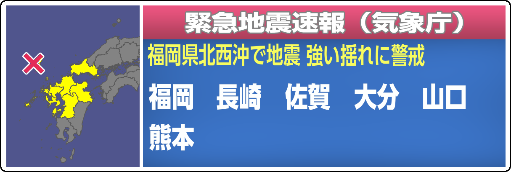

# NHK 緊急地震速報 画面生成器

用 Rust 从零实现的仿 NHK「緊急地震速報（気象庁）」画面生成器。不依赖任何图像库或 GUI 框架：
PNG 编解码、矢量填充与抗锯齿、CFF 字体轮廓解析、地图投影绘制、HTTP 服务全部为手写实现，
只用一个 `ttf-parser` 解析字体表。



## 能力

- **手动生成**：浏览器界面输入震源经纬度、勾选警报府県予報区，实时预览并下载 PNG
- **实时待机**：轮询 [P2P地震情報 API](https://www.p2pquake.net/develop/json_api_v2/) 的 `code=556`
  （緊急地震速報／警報），新报文自动出图，文件名为 `<eventId>_<serial>.png`；取消报自动输出取消画面
- **震央地名自动判定**：按 `震央地名.geojson` 的多边形反查，无需手填
- **地区名自动整合**：完全按 NHK 的排版法则处理（见下）
- **PWA**：界面可安装为桌面／手机应用，离线也能打开外壳
- **开机自启 + 自愈常驻**：计划任务登录即启，守护脚本在进程异常退出后自动拉起

## 快速开始

```bash
cargo build --release

# 手动界面（默认 http://127.0.0.1:18787，端口被占用时自动顺延）
./target/release/eew-generator

# 实时待机（轮询 556，自动出图到 output/auto）
./target/release/eew-generator --auto

# 复现仓库中的示例图
./target/release/eew-generator --demo

# 离线回放 556 报文，验证命名与渲染
./target/release/eew-generator --from-json sample_556.json --outdir output/replay
```

其余参数见 `--help`：`--lat/--lon/--name/--prefs/--cancel/--out/--outdir/--interval/--port/--log`。

## 安装为应用（PWA）

界面自带 `manifest.webmanifest` 与 Service Worker，可安装成独立窗口应用：

- 桌面 Chrome / Edge：地址栏右侧「安装」图标，或界面右上角「安装到桌面」
- Android Chrome：菜单 →「安装应用」
- iOS Safari：分享 →「添加到主屏幕」（界面右上角会出现对应引导按钮）

Service Worker 只缓存界面外壳（HTML / 图标 / manifest），生成请求始终走本地服务：
离线时界面仍能打开，但会提示「本地生成服务未运行」。

> 浏览器仅在安全上下文注册 Service Worker，所以 `http://127.0.0.1` 与 `https://` 可用；
> 若以 `http://<局域网 IP>:18787` 访问，界面正常但安装与离线能力不会生效。

## 开机自启与常驻（Windows）

```powershell
powershell -NoProfile -ExecutionPolicy Bypass -File tools\install_autostart.ps1    # 注册并立即启动
powershell -NoProfile -ExecutionPolicy Bypass -File tools\uninstall_autostart.ps1  # 停止并删除任务
```

计划任务 `EEW-Generator-Standby` 的行为：

| 项 | 说明 |
|---|---|
| 触发 | 用户登录后 15 秒启动；另配每 10 分钟一次的看门狗触发 |
| 多实例 | 任务级 `IgnoreNew` + 脚本内命名互斥体，保证只有一个守护进程 |
| 时长 | `ExecutionTimeLimit=PT0S`，不因超时被结束 |
| 失败重试 | 每 1 分钟重试，最多 999 次 |
| 守护 | `tools/standby.ps1` 隐藏窗口托管子进程，退出后 5 秒重启（存活不足 15 秒则退避 30 秒） |

日志：

- `output/auto/standby.log` —— 程序日志：启动、每次出图、取数故障与恢复、每 20 分钟心跳；超过 4MB 轮转为 `.1`
- `output/auto/supervisor.log` —— 守护日志：每次拉起与被托管进程的退出码

手动停止：跑卸载脚本，或 `Stop-ScheduledTask -TaskName EEW-Generator-Standby`。

## 地区名排版法则

默认显示府県予報区名，每行最多 **14 字**（词间空隙计 1 字），最多两行；超过两行时切换为
地方予報区名，并遵循：

1. 地方内只有 1 个区域时，保留该区域名（如「福井」不并入「北陸」、「福島」不并入「東北」）
2. 新潟、伊豆諸島、小笠原、奄美等岛屿区域独立列出，不并入所属地方
3. 整合后仍超两行，再以 2px 递减字号压缩

验证用例（`--prefs` 传入对应府县即可复现）：

| 场景 | 输出 |
|---|---|
| 宮城 岩手 福島 秋田 山形 | 一行 5 个府県名 |
| 熊本（九州 + 中国 + 四国） | `九州 中国 四国` |
| 播磨灘 | `近畿 四国 中国 福井 東海` |
| 千葉県南方沖 | `伊豆諸島 関東 東海 福島` / `甲信 新潟` |
| 奈良県 | `近畿 東海 四国 中国 北陸 甲信` / `関東 伊豆諸島 新潟 九州` |

## 实现要点

| 模块 | 说明 |
|---|---|
| `src/png.rs` | 手写 PNG 编码器（filter + 固定 Huffman deflate + CRC32/Adler32）与解码器 |
| `src/font.rs` | 用 `ttf-parser` 取字形轮廓，把二次/三次贝塞尔展平为多边形 |
| `src/canvas.rs` | 扫描线 + 4×4 子采样抗锯齿填充，支持 even-odd 与 alpha 混合、描边、位图叠加 |
| `src/render.rs` | 版式常量、移动视野投影、府県名自动整合与换行、黄色副标题排版 |
| `src/data.rs` | 读取 `data/geometry.bin`（简化后的预报区多边形）与 `data/epicenters.bin` |
| `src/net.rs` | 通过系统 `curl` 取 HTTPS（避免 Windows 下 TLS 依赖 C 编译器），`serde_json` 解析 |
| `src/server.rs` | 手写 HTTP/1.1 服务，内嵌单页界面 + `POST /api/render` 返回 base64 PNG；同源提供 manifest / Service Worker / 图标 |
| `src/auto.rs` | 轮询、去重、按 `eventId_serial` 命名落盘；单次巡检包 `catch_unwind` 防线程猝死，每 20 分钟心跳 |
| `src/log.rs` | 文件日志（本地时间戳、4MB 轮转），后台隐藏运行时唯一的观测入口 |

静态底版（渐变、边框、标题、取消文案）由 `tools/build_background.py` 从示例图分离并拟合重建，
导出为 `assets/bg_alert.bin` / `assets/bg_cancel.bin`；地图、文字、震源标记则在运行时绘制。

## 数据与素材

| 路径 | 内容 |
|---|---|
| `data/geometry.bin` | 府県予報区 / 地方予報区多边形（由气象厅 GIS shapefile 简化而来） |
| `data/epicenters.bin` | 震央地名多边形索引（源：`震央地名.geojson`） |
| `assets/fonts/*.otf` | UD 新ゴシック 6 个字重 |
| `assets/bg_*.bin` | 静态底版 RGBA |
| `assets/x_marker.bin` | 震源 × 标记精灵（始终绘制在最上层） |
| `assets/web/*.png` | PWA 图标（192/512/maskable/apple-touch），由 `tools/build_pwa_icons.py` 生成 |

原始 GIS shapefile（`data/gis/`）与第三方压缩包未入库：单个 `.shp` 超过 100MB，
且运行时已不再需要。重建方式：

```bash
python tools/extract_assets.py    # 解压字体 / GIS
python tools/build_geometry.py    # 重新生成 data/*.bin
```

## 说明

本项目仅用于技术演示与画面还原研究，非气象厅官方产品，输出图像不得用于实际防灾发布。
